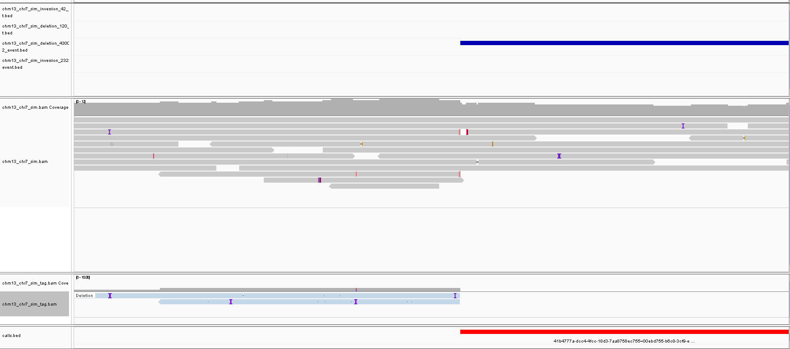
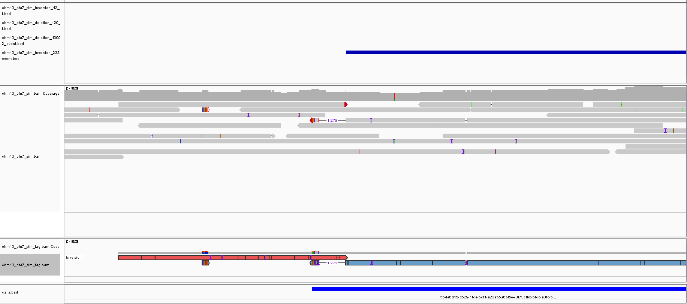
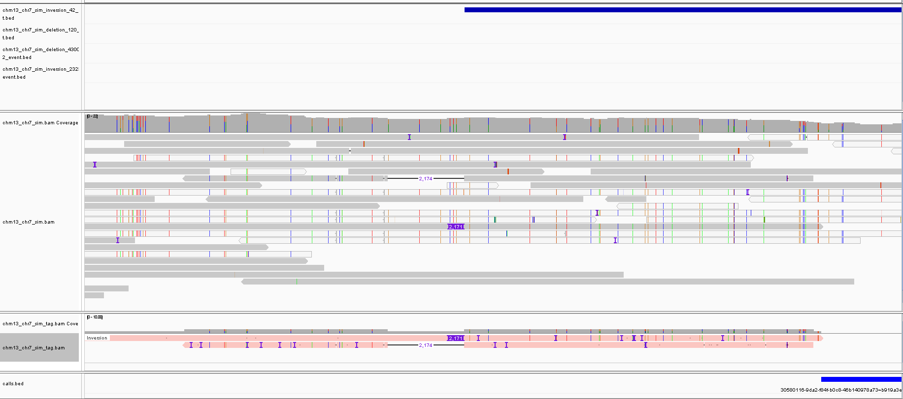

# RECallS
(R)ecombination (E)vent (call)er from (S)perm long-read sequencings data

<table>
  <tr>
    <td>
      <figure>
        
        <br>
        <figcaption>
          IGV screenshot of <b>simulated deletion</b> detected via supplementary read alignments
        </figcaption>
      </figure>
    </td>
    <td>
      <figure>
        
        <br>
        <figcaption>
          IGV screenshot of <b>simulated inversion</b> detected via supplementary read alignments
        </figcaption>
      </figure>
    </td>
    <td>
      <figure>
        
        <br>
        <figcaption>
          IGV screenshot of <b>simulated inversion</b> detected via SNVs in secondary read alignments 
        </figcaption>
      </figure>
    </td>
  </tr>
</table>

## Usage
Align reads to donor-specific assembly.
```bash
minimap -ax lr:hq --eqx -Y  -I8g "${sample}.fa.gz" "${sample}.fq.gz" \
    | samtools sort -u - \
    | samtools view -F 4 -bh -o "${sample}.bam"
```

Compile (Requires rustc >=1.98.0)
```bash
cargo build --release
```

Then run:
```bash
./target/release/RECallS -i "${sample}.bam"
```

## Outputs
Within the output directory (`-o`):
```
recalls
├── calls.bed
├── *.bam
└── chrom_indel_stats.tsv
```

Where:
|name|desc|
|-|-|
|`calls.bed`|Putative intrachromosomal inversion and deletion events|
|`*.bam`|(Optional with `-g`) Tagged BAM file with only reads involved in `calls.bed`. Custom tag `EV` marks what event type.|
|`chrom_indel_stats.tsv`|Chromosome read indel stats for primary and secondary alignments|

## Docs
See [`docs/long_distance.md`](docs/long_distance.md) for overview.

## Test
To generate simulated data in CHM13 chr7.
```bash
# Install dependencies
pixi install
snakemake -c 8 -s test/amplicon/Snakefile -np
```

Then to run:
```bash
./target/release/RECallS \
-i test/amplicon/chm13_chr7_sim.bam \
-n test/amplicon/chm13_chr7_lcr.bed \
-g test/amplicon/chm13_chr7_sim_tag.bam

samtools index test/amplicon/chm13_chr7_sim_tag.bam
```
